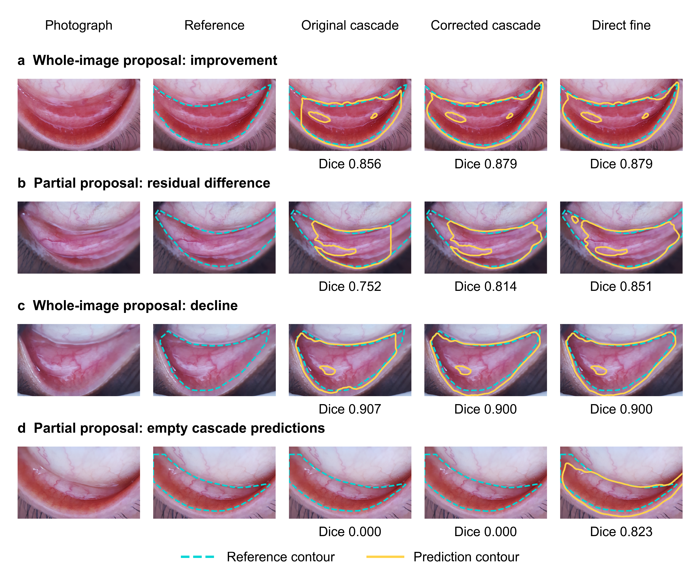

# Conjunctival reconstruction reproducibility

Code, numerical results and figure materials for **Improving Conjunctival Segmentation in Smartphone Images by Preserving Whole-Image Predictions**.

The study examines whether regional reconstruction suppresses useful fine-model predictions, and tests a rule that preserves the fine probability map for an exact whole-image proposal. The comparison uses fixed model checkpoints.

## Quick start

Use Python 3.10 or later and an existing NumPy environment. There is no upper-version restriction. This release was tested with Python 3.12.10; installed dependencies must support the Python version used.

```bash
python verify_release.py
python reproduce.py
```

The default replay recomputes 3,180 public-record Dice values from integer overlap counts, 15 mean confidence intervals and eight paired comparisons, checks 125 whole-image identity receipts, and executes five synthetic reconstruction scenarios. Results are written to `results/statistics/`. It needs no GPU, model weights, network access or training.

To regenerate all five manuscript figures, also provide pandas, Matplotlib and Pillow:

```bash
python reproduce.py --figures
```

This additionally checks the four saved public-image examples against their masks and Dice values, then writes PDF, SVG, 600-dpi PNG and TIFF figures to `results/figures/`. The scripts do not install dependencies automatically. Dependency lists are in `requirements.txt` and `requirements-figures.txt`.

## Principal results

| Public procedure | Mean Dice |
|---|---:|
| Original combined cascade | 0.69833 |
| Corrected cascade | 0.72457 |
| Direct fine inference | 0.76891 |

The corrected-minus-original difference is 0.02624 (95% CI 0.02239–0.03025; Holm-adjusted p = 0.0004). Corrected and direct probabilities coincide in the 125 records for which all five ensemble members propose exactly one whole-image region. The other 87 records contain at least one partial proposal. These are fixed-checkpoint analyses of the evaluated public records.

## Repository contents

| Path | Contents |
|---|---|
| `software/` | Executable scalar analysis, NumPy reconstruction reference, training settings and archived core source |
| `software/data/` | Coded public-record scalars and saved reconstruction receipts |
| `data/figure_inputs/` | Aggregate figure source tables and deterministic synthetic arrays |
| `data/qualitative/` | Four public photographs, source reference masks, three saved prediction masks per record and selection metadata |
| `data/manuscript_tables/` | Tables 1–4 and S1–S5 exported from the manuscript |
| `scripts/` | Portable plotting code and layout checks |
| `figures/` | The five manuscript figures in PNG and PDF |
| `docs/` | Reproducibility scope, data dictionary, figure mapping and access terms |
| `validation/` | Verification receipt from the released files |

Figure 2 is a deterministic mechanism illustration. Figure 5 uses real public images:



## Reproducibility scope

Scalar replay starts from the included integer pixel counts; figure reproduction starts from saved outputs and aggregate tables. The 125 full-probability identities are archived server checks, not fresh comparisons of the complete probability arrays. Figure 5 enables fresh checks of four sets of saved binary masks. The archived `software/frozen_source/` modules expose the original implementation, including training and inference logic, but depend on the larger original project and are not a standalone neural-network distribution.

Institutional photographs, annotations and trained model weights are not shared or available on request because of hospital-imposed confidentiality and ethical restrictions. The repository therefore supports statistical and figure reproduction, but not complete independent model retraining or image inference. See [reproducibility scope](docs/REPRODUCIBILITY.md).

## Dataset attribution and citation

Public photographs and source annotations are from **Eyes-defy-anemia**, Giovanni Dimauro, Rosalia Maglietta, Thulasi Bai and Sivachandar Kasiviswanathan, IEEE DataPort (2022), DOI [10.21227/t5s2-4j73](https://doi.org/10.21227/t5s2-4j73), licensed under [CC BY 4.0](https://creativecommons.org/licenses/by/4.0/). Display crops and prediction contours were added to Figure 5. The source dataset paper is Dimauro et al., *Artificial Intelligence in Medicine* 136 (2023), 102477, DOI [10.1016/j.artmed.2022.102477](https://doi.org/10.1016/j.artmed.2022.102477).

Use `CITATION.cff` to cite this software version. Software licensing and third-party rights are described in [NOTICE.md](NOTICE.md).
